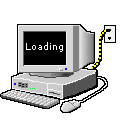

# Purenight34
## 아직 꾸미는 중...
C++과 Unreal Engine을 중심으로 게임 클라이언트 개발자를 지망하고 있습니다.

**Main** · C++ / Unreal Engine 
**Experience** · C# / Unity / Python

[개발 블로그](https://galaxypark34.tistory.com/) · [이메일](mailto:slaehrnt@gmail.com)

---

## Projects

> 프로젝트 화면을 준비하는 동안 각 카드에 임시 로딩 GIF를 표시합니다. 실제 게임 화면이 아닙니다.

<table width="100%">
  <tr>
    <td width="50%" valign="top">
      <h3>DunRaRi</h3>
      
<strong>Unreal Engine · C++</strong> | 개발 중

      
      
방을 배치해 경로를 구성하고 웨이브를 방어하는 Dungeon Defense 프로젝트입니다.

      
<strong>주요 작업</strong> 
      GameInstanceSubsystem 및 DataTable 기반 데이터 관리 · Save / Load 
      Room Graph 및 Path Finding · Wave / Spawn System · Unit Movement / Formation

      
<a href="https://galaxypark34.tistory.com/">개발 일지</a>

    </td>
    <td width="50%" valign="top">
      <h3>Unity Team Project</h3>
      
<strong>Unity</strong> | 팀 프로젝트 · 2023년 완료

      
      
Unity 기반으로 제작한 팀 프로젝트입니다.

      
<strong>담당 기능</strong> 
      Item System · Inventory · Quick Slot · Crafting System · UI 연동

      
<a href="https://github.com/kimwooryong/WooRyong">팀 저장소</a>

    </td>
  </tr>
  <tr>
    <td width="50%" valign="top">
      <h3>Card &amp; Gun</h3>
      
<strong>Unity</strong> | 개인 프로젝트 · 2023년 완료

      
      
3D FPS와 덱빌딩 로그라이크 요소를 결합한 개인 프로젝트입니다.

      
<strong>주요 구현 및 학습</strong> 
      FPS Player Controller · Raycast Shooting · Weapon / Bullet System 
      Enemy / Boss · UI / HUD · Sound Manager · Script Refactoring

      
<a href="https://github.com/Purenight34/CardAndGun">프로젝트 저장소</a>

    </td>
    <td width="50%" valign="top">
      <h3>이터널리턴 DPS 계산기</h3>
      
<strong>Python · C++</strong> | 개인 플레이용 도구

      
      
이터널리턴 플레이를 위해 제작한 DPS 계산기입니다.

      
<a href="https://github.com/Purenight34/ER_DPS">프로젝트 저장소</a>

    </td>
  </tr>
  <tr>
    <td width="50%" valign="top">
      <h3>SSAFY 프로젝트</h3>
      
<strong>팀 프로젝트</strong>

      
      
SSAFY에서 진행한 프로젝트입니다. 반응형 웹과 지도 시각화를 구현하고 배포했습니다.

      
<a href="https://github.com/Purenight34/ODEGO-netlify">프로젝트 저장소</a>

    </td>
    <td width="50%" valign="top"></td>
  </tr>
</table>

임시 GIF: [90's Computer Loading Amination](https://opengameart.org/content/90s-computer-loading-amination) · MrRar · CC0

비공개 SSAFY 프로젝트

- [API 호출 연습](https://lab.ssafy.com/slaehrnt/pjt02) · 비공개

---

## Study

### Algorithm &amp; Data Structure Study

알고리즘을 의사코드로 작성해 문제를 제출하고 각자 풀어보는 스터디를 진행하고 있습니다. 
[스터디 저장소](https://github.com/Purenight34/Study)

비공개 스터디

- 문제 풀이 중심의 [스터디 저장소](https://github.com/GrayBoxTool/DeepBlueSea) · 비공개

### Personal Study

개인 학습 내용과 메모를 기록합니다. 
[개인 학습 저장소](https://github.com/Purenight34/Study_Personal)

---

## Contact

- [개발 기록 티스토리](https://galaxypark34.tistory.com/)
- [GitHub 프로필](https://github.com/Purenight34)
- [이메일](mailto:slaehrnt@gmail.com)
